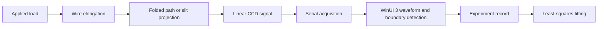

# Young's Modulus Optical Measurement Instrument

Offline C# instrument software, measurement-principle notes, and original project documents from our entry to the 2025 National Undergraduate Physics Experiment Competition (Innovation). The project, **Optical Improvement and Remote Pre-Lab Device for Young's Modulus Measurement**, received Third Prize at the 11th competition.

The work restructured the tensile-method experiment around two optical routes and a digital acquisition workflow:

- a folded optical path that keeps the optical-lever principle visible;
- a slit/laser/linear-CCD route that converts wire deformation into changes in an optical feature;
- an offline WinUI 3 application for CCD serial acquisition, waveform display, experiment records, fitting, and report-oriented data handling;
- an online pre-lab component designed by teammate 丁庆祥, which is a separate contribution and is not part of this repository.


## Measurement Workflow



The software is designed around the experiment sequence rather than a generic plotting interface. It supports system checks, serial acquisition, live curves, feature-boundary detection, calibration/settings pages, data records, export/import, fitting, and emergency stop handling.

The numerical result depends on the physical setup: wire condition, optical alignment, loading method, CCD scale, and calibration parameters. This repository therefore documents the method and software flow without publishing one result table as a universal benchmark.

## Repository Map

| Path | Contents |
|---|---|
| `app/YoungsModuleTest/` | Original C# / .NET 9 / WinUI 3 desktop application. |
| `simulations/simulated_ccd_reader.py` | Later hardware-independent demonstration of CCD feature extraction. |
| `simulations/uncertainty_budget.py` | Later educational calculation of Young's modulus and uncertainty propagation. |
| `docs/physics-model.md` | Measurement principle and instrument design. |
| `docs/software-architecture.md` | WinUI 3 pages and application structure. |
| `docs/measurement-data-flow.md` | Acquisition, record, and fitting data flow. |
| `docs/csharp-implementation-pseudocode.md` | Pseudocode map of the original C# application. |
| `docs/software-operation-guide.md` | Software operation guide extracted for browser reading. |
| `docs/visual-supplement.md` | Project-owned instrument and interface images. |
| `docs/source-materials/` | Original reviewed Word/PPT project documents. |
| `docs/vendor-tooling-notes.md` | CCD module, serial tool, driver, and redistribution notes. |

The Python files under `simulations/` were written later to explain the principle without physical hardware. They are not the original instrument-control program; the original implementation is the C# application under `app/YoungsModuleTest/`.

## Build The Offline Application

Requirements:

- Windows 10 version 1809 or later;
- .NET 9 SDK;
- Visual Studio with WinUI / Windows App SDK tooling, or an equivalent command-line environment.

```powershell
dotnet restore app/YoungsModuleTest/YoungsModuleTest.csproj
dotnet build app/YoungsModuleTest/YoungsModuleTest.csproj -c Release -p:Platform=x64
```

The serial-port and CCD workflow still requires the matching physical module, wiring, protocol, and setup-specific calibration.

## Original Project Documents

- [仪器讲解.docx](docs/source-materials/仪器讲解.docx): instrument design, principle, experiment workflow, and project report.
- [程序操作.docx](docs/source-materials/程序操作.docx): WinUI 3 operation guide.
- [演讲版本.pptx](docs/source-materials/演讲版本.pptx): original presentation deck.

For browser reading, start with [project context](docs/project-context-and-scope.md), [physics model](docs/physics-model.md), [software architecture](docs/software-architecture.md), and [visual supplement](docs/visual-supplement.md).

## Team

The device, software, experiment workflow, data processing, report, and presentation were completed as a team project under the guidance of 吴建海 and 宇霄.

| Member | Main contribution |
|---|---|
| 丁庆祥 | Online pre-lab and remote-learning software. |
| 朱兆兴 | Mechanical structure. |
| 田秉卓 | Offline C# instrument program in this repository and measurement-principle design; maintains this repository. |
| 郭智美 | Measurement-principle design and data processing. |
| 赵思梦 | Measurement-principle design and data processing. |

## License And Reuse

The C# application, later simulations, documentation, images, and original Office files do not all have identical authorship. Apache-2.0 applies only where the relevant rights holder has granted it. Read [LICENSE_SCOPE.md](LICENSE_SCOPE.md) and [NOTICE](NOTICE) before reuse. Third-party CCD tools, drivers, and vendor files follow their own terms and are not covered by this repository's license.

---

# 中文说明

本仓库整理的是我们参加 2025 年全国大学生物理实验竞赛（创新）的作品“杨氏模量测量实验的光学改进及远程预习装置”中的线下 C# 仪器软件、测量原理说明和原始项目文档。项目获第十一届全国大学生物理实验竞赛三等奖。

项目围绕传统拉伸法重新组织了两条光学测量路径和一套数字采集流程：

- 光路折叠法保留光杠杆原理的直观展示；
- 狭缝、激光和线阵 CCD 把钢丝形变转化为光学特征变化；
- 线下 WinUI 3 程序负责 CCD 串口采集、波形显示、实验记录、拟合和面向报告的数据处理；
- 队友丁庆祥负责在线预习组件，该部分是独立贡献，不在本仓库中。

## 测量与软件流程

软件围绕真实实验步骤设计，而不是一个通用绘图界面。它包含系统检查、串口采集、实时曲线、特征边界识别、标定与设置、实验记录、导入导出、拟合和急停处理。

杨氏模量结果依赖具体装置的钢丝状态、光路对准、加载方式、CCD 比例和标定参数。因此，本仓库重点公开测量方法和软件流程，不把某一组实验结果当作通用性能基准。

## 仓库结构

| 路径 | 内容 |
|---|---|
| `app/YoungsModuleTest/` | 原始 C# / .NET 9 / WinUI 3 桌面程序。 |
| `simulations/simulated_ccd_reader.py` | 后续编写的不依赖硬件的 CCD 特征提取演示。 |
| `simulations/uncertainty_budget.py` | 后续编写的杨氏模量与不确定度传播教学计算。 |
| `docs/physics-model.md` | 测量原理和仪器设计。 |
| `docs/software-architecture.md` | WinUI 3 页面与程序结构。 |
| `docs/measurement-data-flow.md` | 采集、记录和拟合的数据流。 |
| `docs/csharp-implementation-pseudocode.md` | 原始 C# 程序逻辑的伪代码索引。 |
| `docs/software-operation-guide.md` | 适合网页阅读的软件操作说明。 |
| `docs/visual-supplement.md` | 来自项目材料的仪器和界面图片。 |
| `docs/source-materials/` | 已审核的原始 Word/PPT 项目文档。 |
| `docs/vendor-tooling-notes.md` | CCD 模块、串口工具、驱动和再分发说明。 |

`simulations/` 下的 Python 文件是后续为解释原理编写的，不是原始仪器控制程序。原始实现是 `app/YoungsModuleTest/` 下的 C# 应用。

## 构建线下程序

需要 Windows 10 1809 或更高版本、.NET 9 SDK，以及 Visual Studio 的 WinUI / Windows App SDK 工具链或等效命令行环境。

```powershell
dotnet restore app/YoungsModuleTest/YoungsModuleTest.csproj
dotnet build app/YoungsModuleTest/YoungsModuleTest.csproj -c Release -p:Platform=x64
```

串口和 CCD 流程仍需要匹配的物理模块、接线、协议和针对当前装置重新测量的标定参数。

## 原始项目文档

- [仪器讲解.docx](docs/source-materials/仪器讲解.docx)：仪器设计、原理、实验流程和项目报告。
- [程序操作.docx](docs/source-materials/程序操作.docx)：WinUI 3 操作指南。
- [演讲版本.pptx](docs/source-materials/演讲版本.pptx)：原始答辩演示文稿。

网页阅读可从[项目背景](docs/project-context-and-scope.md)、[测量原理](docs/physics-model.md)、[软件架构](docs/software-architecture.md)和[图片补充](docs/visual-supplement.md)开始。

## 团队分工

装置、软件、实验流程、数据处理、报告和展示均由团队在吴建海、宇霄老师指导下共同完成。

| 成员 | 主要贡献 |
|---|---|
| 丁庆祥 | 在线预习与远程学习软件。 |
| 朱兆兴 | 机械结构。 |
| 田秉卓 | 本仓库中的线下 C# 仪器程序和测量原理设计；维护本仓库。 |
| 郭智美 | 测量原理设计与数据处理。 |
| 赵思梦 | 测量原理设计与数据处理。 |

## 许可与复用

C# 程序、后续模拟、说明文档、图片和原始 Office 文件的作者范围并不完全相同。Apache-2.0 只在相关权利人确实授权的范围内适用。复用前请阅读 [LICENSE_SCOPE.md](LICENSE_SCOPE.md) 和 [NOTICE](NOTICE)。第三方 CCD 工具、驱动和厂商文件遵循各自条款，不属于本仓库许可范围。
