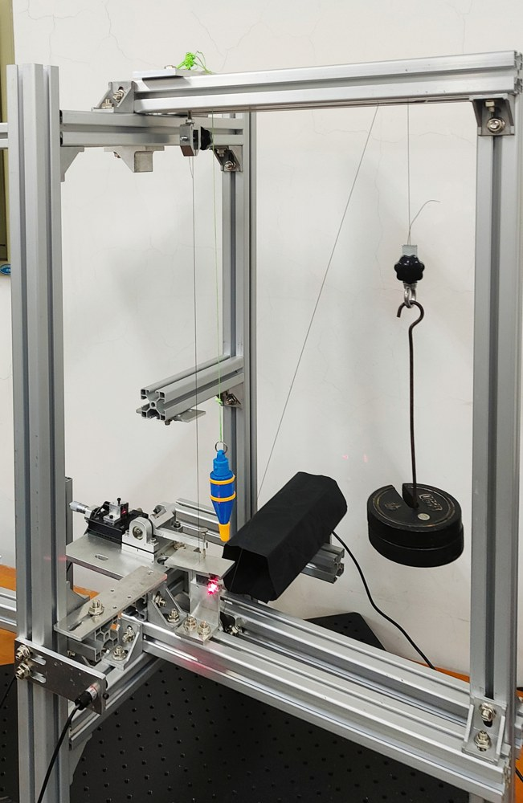
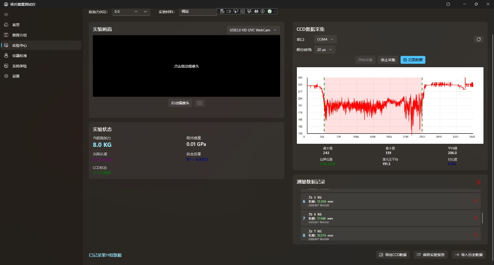

# Young's Modulus Optical Measurement Instrument

This repository documents our team's Young's modulus experiment-improvement project for the 2025 National Undergraduate Physics Experiment Competition (Innovation). The project is titled **Optical Improvement and Remote Pre-Lab Device for Young's Modulus Measurement**.

## Project At A Glance

| Item | Summary |
|---|---|
| Competition | 2025 National Undergraduate Physics Experiment Competition (Innovation). |
| System type | Young's modulus optical measurement instrument with folded optical path, projection/CCD route, and offline WinUI 3 software. |
| Repository focus | Offline C# instrument software, original project materials, public-readable docs, visual supplement, and hardware-independent Python explanations. |
| My role | Uploaded offline program design and measurement-principle design, plus public repository maintenance. |
| Not included | Online pre-lab software, unreviewed raw experiment-result data, packaged Windows outputs, local IDE state, signing certificates, and third-party executable tools. |

## Project Highlights

- One instrument, two measurement methods: folded optical path (keeping the traditional light-lever visualization) and projection (slit + laser + linear CCD, converting wire deformation into measurable optical feature changes).
- Mechanical structure is aluminum-profile tripod with custom wire fixtures and a pulley loading mechanism. This part took the most trial and error: we kept running into stability issues with the original setup, so we redesigned it from scratch.
- WinUI 3 desktop app handles serial CCD data acquisition, real-time curve display, boundary detection, experiment records, data export, least-squares fitting, and emergency stop. Once you have two or more data points, it'll fit Young's modulus for you.
- There was also a remote pre-lab concept (teammate Ding Qingxiang's work, not included here) so students could study the principle before coming to the lab.
- This repository contains the offline WinUI 3 instrument program and public-readable documentation.

The core idea wasn't just "move the traditional experiment onto a computer." We tried to rethink how the tiny-deformation measurement in the stretching method could be organized into a more stable, more intuitive, and more teaching-friendly system:

- The folded optical path method preserves and strengthens the visual understanding of the optical-lever principle.
- The projection method uses a slit, a point/line light source, and a linear CCD to turn wire deformation into measurable changes in optical feature size.
- On the software side, the program reads CCD data over serial, draws a real-time curve, detects boundaries and feature dimensions, and combines the applied force, wire diameter, original length, and CCD scale factor to calculate Young's modulus.
- After recording two or more data points, the software uses least-squares fitting to compute Young's modulus and fitting quality.
- The online pre-lab setup was meant to bring together the experiment principle, simulated operation, and remote observation, so students could prepare more effectively before the actual lab session.

Because Young's modulus measurements depend strongly on instrument calibration, sample condition, and local setup, this public repository focuses on the measurement system and workflow rather than presenting one set of result data as a universal benchmark.

## Visual Materials

The images below are extracted from our project's own Word/PPT materials.





## Repository Layout

| Path | Description |
|---|---|
| `app/YoungsModuleTest/` | Original WinUI 3 / .NET C# desktop application source code. |
| `simulations/simulated_ccd_reader.py` | Hardware-independent Python simulation for understanding CCD feature extraction. |
| `simulations/uncertainty_budget.py` | Hardware-independent Python calculation demo for Young's modulus and uncertainty. |
| `docs/project-context-and-scope.md` | Project scope, competition context, and explicit team contribution notes. |
| `docs/contribution-scope.md` | Team contribution split, public repository boundaries, and result-data note. |
| `docs/physics-model.md` | Measurement principle and instrument design notes. |
| `docs/software-architecture.md` | Desktop software architecture and main pages. |
| `docs/measurement-data-flow.md` | CCD acquisition and experiment-record data flow. |
| `docs/csharp-implementation-pseudocode.md` | Pseudocode summary of the original C# application logic. |
| `docs/vendor-tooling-notes.md` | Notes on TCD1304 CCD customer materials, SSCOM, CH340 drivers, and third-party redistribution scope. |
| `docs/visual-supplement.md` | Representative images extracted from the original Word/PPT materials. |
| `docs/project-report-extract.md` | Markdown extraction of the original project report. |
| `docs/software-operation-guide.md` | Markdown extraction of the original software operation guide. |
| `docs/presentation-outline.md` | Extracted text outline from the presentation deck. |
| `docs/source-materials/` | Original Word/PPT source materials preserved for reference. |

Run:

```bash
python simulations/simulated_ccd_reader.py
python simulations/uncertainty_budget.py
```

The original software is the C# WinUI 3 application under `app/YoungsModuleTest/`. The Python files under `simulations/` are later public-facing, hardware-independent explanations; they are not the original control program.

## Application Snapshot

The application source keeps the main WinUI 3 pages, project metadata, and app assets. Local build outputs, `.vs/`, `bin/`, `obj/`, signing certificates, user-specific publish files, and packaged executables are not committed.

Third-party CCD module tools, serial assistants, USB-to-serial drivers, and Visual Studio installers are not mirrored in this repository unless their redistribution terms are clear. See `docs/vendor-tooling-notes.md`.

Main UI source locations:

- `app/YoungsModuleTest/MainWindow.xaml`
- `app/YoungsModuleTest/Views/HomePage.xaml`
- `app/YoungsModuleTest/Views/ExperimentPage.xaml`
- `app/YoungsModuleTest/Views/SettingsPage.xaml`

## Source Documents

The original project documents are now included under `docs/source-materials/`:

- `仪器讲解.docx`
- `程序操作.docx`
- `演讲版本.pptx`

For quick reading on GitHub, see:

- `docs/project-context-and-scope.md`
- `docs/contribution-scope.md`
- `docs/project-report-extract.md`
- `docs/software-operation-guide.md`
- `docs/vendor-tooling-notes.md`
- `docs/presentation-outline.md`
- `docs/visual-supplement.md`

## Team And Copyright

This project was developed by a student team. The published competition report records the team members as Ding Qingxiang, Zhu Zhaoxing, Tian Bingzhuo, Guo Zhimei, and Zhao Simeng, with guidance from Wu Jianhai and Yu Xiao. The design, device assembly, software development, experiment operation, data processing, report writing, and presentation work were completed collaboratively.

Known contribution split for the current public-repository scope:

| Member | Main contribution |
|---|---|
| 丁庆祥 | Online pre-lab software / remote learning software. This part is not included in the current repository. |
| 朱兆兴 | Mechanical structure. |
| 田秉卓 | Offline program design included in this repository, plus measurement-principle design. |
| 郭智美 | Measurement-principle design and data processing. |
| 赵思梦 | Measurement-principle design and data processing. |

Unless otherwise stated, code and documents authored for this repository are released under the Apache License 2.0 to the extent the contributors have the right to license them. Third-party drivers, SDKs, documents, and device-vendor materials retain their original licenses.

---

# 中文版本

杨氏模量光学测量实验仪

本仓库整理的是我们团队参加 2025 年全国大学生物理实验竞赛（创新）的作品资料——"杨氏模量测量实验的光学改进及远程预习装置"。

## 项目一览

| Item | Summary |
|---|---|
| Competition | 2025 National Undergraduate Physics Experiment Competition (Innovation). |
| System type | Young's modulus optical measurement instrument with folded optical path, projection/CCD route, and offline WinUI 3 software. |
| Repository focus | Offline C# instrument software, original project materials, public-readable docs, visual supplement, and hardware-independent Python explanations. |
| My role | Uploaded offline program design and measurement-principle design, plus public repository maintenance. |
| Not included | Online pre-lab software, unreviewed raw experiment-result data, packaged Windows outputs, local IDE state, signing certificates, and third-party executable tools. |

## 项目亮点

- 一台仪器、两种测量方法：光路折叠法（保留传统光杠杆的可视化理解）和投影法（狭缝 + 激光 + 线阵 CCD，把钢丝形变转化为可测量的光学特征变化）。
- 机械结构是铝型材三脚架，配合定制夹具和滑轮加力机构——说实话这部分反复改了好几版，传统装置老晃，我们干脆重新设计了。
- WinUI 3 桌面程序负责串口 CCD 数据采集、实时曲线显示、边界识别、实验记录、数据导出、最小二乘拟合以及紧急停机。记录两组及以上数据后，程序会自动拟合杨氏模量。
- 还有一个远程预习装置的概念（队友丁庆祥负责，不在本仓库中），让学生提前在线上了解实验原理。
- 本仓库包含线下 WinUI 3 仪器程序和公开可读的文档。

核心思路不是简单"把传统实验搬到电脑上"，而是把传统拉伸法中的微小形变测量重新组织为一套更稳定、更直观、更适合教学的实验系统：

- 光路折叠法用于保留和强化光杠杆原理的可视化理解。
- 投影法利用狭缝、点光源/线光源和线阵 CCD，将钢丝形变量转化为可采集的光学特征尺寸变化。
- 软件端通过串口读取 CCD 数据，绘制实时曲线，识别边界/特征尺寸，并结合施加力、钢丝直径、原长和 CCD 比例参数计算杨氏模量。
- 当记录两组及以上数据后，程序可用最小二乘法计算当前材料的杨氏模量和拟合质量。
- 线上预习装置用于把实验原理、模拟操作和远程观察结合起来，提高正式实验前的理解效率。

杨氏模量测量结果受仪器标定、样品状态和现场环境影响很大，所以本公开仓库的重点放在测量系统和工作流程上，而不是把某一组数据当作通用基准。

## 图片资料

以下图片均提取自项目原始的 Word/PPT 材料。


## 仓库结构

| Path | Description |
|---|---|
| `app/YoungsModuleTest/` | Original WinUI 3 / .NET C# desktop application source code. |
| `simulations/simulated_ccd_reader.py` | Hardware-independent Python simulation for understanding CCD feature extraction. |
| `simulations/uncertainty_budget.py` | Hardware-independent Python calculation demo for Young's modulus and uncertainty. |
| `docs/project-context-and-scope.md` | Project scope, competition context, and explicit team contribution notes. |
| `docs/contribution-scope.md` | Team contribution split, public repository boundaries, and result-data note. |
| `docs/physics-model.md` | Measurement principle and instrument design notes. |
| `docs/software-architecture.md` | Desktop software architecture and main pages. |
| `docs/measurement-data-flow.md` | CCD acquisition and experiment-record data flow. |
| `docs/csharp-implementation-pseudocode.md` | Pseudocode summary of the original C# application logic. |
| `docs/vendor-tooling-notes.md` | Notes on TCD1304 CCD customer materials, SSCOM, CH340 drivers, and third-party redistribution scope. |
| `docs/visual-supplement.md` | Representative images extracted from the original Word/PPT materials. |
| `docs/project-report-extract.md` | Markdown extraction of the original project report. |
| `docs/software-operation-guide.md` | Markdown extraction of the original software operation guide. |
| `docs/presentation-outline.md` | Extracted text outline from the presentation deck. |
| `docs/source-materials/` | Original Word/PPT source materials preserved for reference. |

运行：

```bash
python simulations/simulated_ccd_reader.py
python simulations/uncertainty_budget.py
```

原始软件是 `app/YoungsModuleTest/` 下的 C# WinUI 3 应用。`simulations/` 下的 Python 文件是后来为公开展示写的、不依赖硬件的原理说明，不是原始控制程序。

## 应用快照

应用源码保留了主要的 WinUI 3 页面、项目元数据和应用资源。本地构建产物、`.vs/`、`bin/`、`obj/`、签名证书、用户特定的发布文件和打包的可执行文件均未提交。

第三方 CCD 模块工具、串口调试助手、USB 转串口驱动和 Visual Studio 安装程序没有镜像到本仓库，除非其再分发条款明确允许。详见 `docs/vendor-tooling-notes.md`。

主要 UI 源码位置：

- `app/YoungsModuleTest/MainWindow.xaml`
- `app/YoungsModuleTest/Views/HomePage.xaml`
- `app/YoungsModuleTest/Views/ExperimentPage.xaml`
- `app/YoungsModuleTest/Views/SettingsPage.xaml`

## 原始文档

原始项目文档已包含在 `docs/source-materials/` 下：

- `仪器讲解.docx`
- `程序操作.docx`
- `演讲版本.pptx`

如需在 GitHub 上快速阅读，可以参考：

- `docs/project-context-and-scope.md`
- `docs/contribution-scope.md`
- `docs/project-report-extract.md`
- `docs/software-operation-guide.md`
- `docs/vendor-tooling-notes.md`
- `docs/presentation-outline.md`
- `docs/visual-supplement.md`

## 团队与版权

本项目由学生团队完成。竞赛报告记载的团队成员为丁庆祥、朱兆兴、田秉卓、郭智美、赵思梦，指导教师为吴建海和宇霄。方案设计、装置搭建、软件开发、实验操作、数据处理、报告撰写和答辩展示均由团队共同完成。

当前公开仓库范围内的已知分工如下：

| 成员 | 主要贡献 |
|---|---|
| 丁庆祥 | 在线版软件 / 远程预习软件；该部分不在当前仓库中。 |
| 朱兆兴 | 机械结构。 |
| 田秉卓 | 当前仓库上传的线下仪器程序设计，以及测量原理设计。 |
| 郭智美 | 测量原理设计与数据处理。 |
| 赵思梦 | 测量原理设计与数据处理。 |

本项目为团队竞赛成果。软件、硬件、实验操作、报告、视频、数据处理和展示材料均有队友共同参与，每位成员都应获得相应尊重。本仓库由田秉卓维护，用于整理其中可公开复盘的工程代码与说明。

除非另有说明，本仓库中由贡献者编写的代码和文档在贡献者有权许可的范围内以 Apache License 2.0 发布。第三方驱动、SDK、文档和设备供应商材料保留其原始许可。
