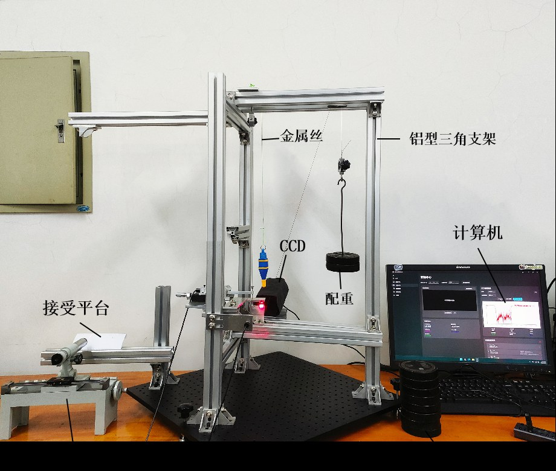

# Measurement Principle And Instrument Design

This document expands on the measurement principle from our original project report. The full extracted report is in `docs/project-report-extract.md`, and the original Word report is preserved in `docs/source-materials/仪器讲解.docx`.

## Problem Background

Young's modulus measurement is a classic college physics experiment. It ties together Hooke's law, material mechanics, length measurement, optical amplification, and error analysis. In traditional teaching instruments, the measurement itself is meaningful, but the operation often has several pain points that we ran into ourselves:

- **Insufficient stability:** the traditional frame can shake during loading and adjustment, causing visible data fluctuation.
- **Difficult operation:** students often spend too much time adjusting the telescope, mirror angle, and reading device before they can obtain usable data.
- **Invisible optical path:** the optical-lever principle is abstract, and students may know the formula without forming a clear physical image.
- **Manual reading error:** subjective reading and repeated manual calculation introduce avoidable uncertainty.

The project responds to these problems by improving the mechanical frame, integrating two optical measurement routes, adding CCD-based reading, and designing a remote pre-lab workflow.



## Overall Measurement Chain

```text
loading force
  -> wire deformation
  -> optical amplification
  -> folded optical path / projection path
  -> microscope reading or CCD feature extraction
  -> displacement estimation
  -> Young's modulus calculation
  -> uncertainty and fitting-quality analysis
```

## Mechanical Structure

The instrument uses an aluminum-profile triangular frame as the main support. The wire is fixed by customized clamps, and the loading process is stabilized by a pulley-based mechanism instead of direct weight loading. This structure was meant to reduce wire shaking and improve repeatability -- and in practice, the difference was quite noticeable compared to the original setup.

The instrument body includes:

- metal wire and wire-locking fixtures;
- fixed pulley groups and loading components;
- movable L-shaped platforms coupled to wire elongation;
- leveling knobs and plumb-line observation for horizontal adjustment;
- optical modules for folded optical path and projection measurement.

## Folded Optical Path Method

The folded optical path method is derived from the traditional stretching method and optical-lever principle. Wire elongation drives the movable platform, changing the angle of the moving mirror. The optical path is then redirected through moving and fixed mirrors, finally forming a readable displacement on the receiving plane or microscope.

This method keeps the optical amplification principle visible, which was important to us:

- the optical path can be traced directly;
- the operation is more compact than moving a separate telescope and scale;
- the result can be used as an independent measurement route;
- it can cross-check the result from the projection method.

## Projection Method With Linear CCD

The projection method uses a laser, slit, and linear CCD. When the wire elongates, the slit width changes. The projected optical feature on the CCD changes accordingly. The software reads CCD intensity data through the serial port and estimates the optical feature size.

The project report describes the geometric relationship through similar triangles. In the software operation notes, the CCD scale factor is recorded as approximately `0.343`, corresponding to the ratio between optical distances in the instrument setup.

The projection route contributes two important improvements:

- it replaces subjective manual reading with software-assisted feature extraction;
- it turns the deformation process into a visible, recordable intensity curve.

## Dual-Method Verification

The main design value isn't just "automation" -- it's **one instrument with two measurement methods**:

- folded optical path method: suitable for principle visibility and manual verification;
- projection method: suitable for CCD acquisition, automated reading, and data processing.

When the two methods produce close Young's modulus values and both show lower uncertainty than the traditional method, the result becomes more convincing for teaching and experiment demonstration.

## Teaching Workflow

The project also adds a remote pre-lab concept. Students can use an online platform to learn the principle and interact with the experiment before entering the offline class. The goal is to make offline time focus on measurement, comparison, and error analysis instead of basic principle familiarization.

---

# 中文版本

本文件展开了原始项目报告中的测量原理部分。完整的提取版报告在 `docs/project-report-extract.md`，原始 Word 报告保存在 `docs/source-materials/仪器讲解.docx`。

## 问题背景

杨氏模量测量是大学物理实验中的经典项目，它把胡克定律、材料力学、长度测量、光学放大和误差分析串在了一起。在传统教学仪器中，测量本身是有意义的，但操作过程往往有几个我们亲身体会过的痛点：

- **稳定性不足：** 传统支架在加载和调节时容易晃动，数据跟着波动明显。
- **操作难度大：** 学生经常要花太多时间调望远镜、反射镜角度和读数装置，才能拿到可用的数据。
- **光路不直观：** 光杠杆原理很抽象，学生可能记住了公式却建立不起清晰的物理图像。
- **人工读数误差：** 主观读数和反复手工计算引入了可以避免的不确定度。

项目针对这些问题做了改进：加固机械支架、集成两条光学测量路线、加入 CCD 读数，以及设计远程预习流程。


## 整体测量链路

```text
loading force
  -> wire deformation
  -> optical amplification
  -> folded optical path / projection path
  -> microscope reading or CCD feature extraction
  -> displacement estimation
  -> Young's modulus calculation
  -> uncertainty and fitting-quality analysis
```

## 机械结构

仪器以铝型材三角架作为主支撑。钢丝由定制夹具固定，加载过程通过滑轮机构来稳定施力，而不是直接挂砝码。这个设计是为了减少钢丝晃动、提高重复性——实际用下来和原来的装置对比确实好了很多。

仪器主体包括：

- 金属丝及钢丝锁紧装置（夹具）；
- 固定滑轮组及加载组件；
- 与钢丝伸长联动的可移动 L 型平台；
- 调平旋钮与铅垂线观测，用于水平调节；
- 光路折叠法和投影法的光学模块。

## 光路折叠法

光路折叠法从传统拉伸法和光杠杆原理改进而来。钢丝伸长带动可移动平台，改变动反射镜的角度。光路再经过动反射镜和固定反射镜的多次变向，最终在接收平面或显微镜上形成可读的位移。

这个方法让光学放大原理始终可见，这对我们来说很重要：

- 光路可以直接追踪；
- 操作比移动独立的望远镜和标尺更紧凑；
- 结果可以作为独立的测量路线使用；
- 可以和投影法的结果互相验证。

## 投影法与线阵 CCD

投影法使用激光器、狭缝和线阵 CCD。钢丝伸长时，狭缝宽度发生变化，投影到 CCD 上的光学特征也随之改变。软件通过串口读取 CCD 光强数据，估算光学特征尺寸。

项目报告中用相似三角形描述了几何关系。在软件操作说明中，CCD 比例系数记录为约 `0.343`，对应仪器装置中光路距离的比值。

投影法带来了两个重要改进：

- 用软件辅助的特征提取替代主观人工读数；
- 把形变过程变成可见、可记录的光强曲线。

## 双方法验证

主要的设计价值不只是"自动化"，而是**一台仪器、两种测量方法**：

- 光路折叠法：适合原理可视化和人工验证；
- 投影法：适合 CCD 采集、自动读数和数据处理。

当两种方法得到接近的杨氏模量值，且不确定度都低于传统方法时，结果在教学和实验展示中就更有说服力。

## 教学工作流

项目还加入了远程预习的概念。学生可以通过线上平台在进实验室之前学习原理、模拟操作。目标是让线下时间集中在测量、对比和误差分析上，而不是花在基础原理的初步了解上。
