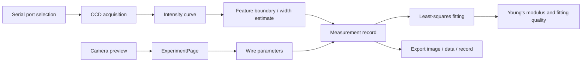

# Software Architecture

This document describes the software architecture of our desktop application. The full extracted operation guide is in `docs/software-operation-guide.md`, and the original Word file is preserved in `docs/source-materials/程序操作.docx`.

The application is a WinUI 3 / .NET program for the Young's modulus instrument. It covers experiment navigation, CCD serial acquisition, camera observation, experiment records, import/export, parameter setting, real-time plotting, least-squares fitting, and emergency stop/reset.

Scope note: this document describes the offline WinUI 3 instrument program included in this repository. The online pre-lab software mentioned in the project report was handled separately by a teammate and is not part of this repository.

For implementation-level pseudocode that follows the original C# program, see `docs/csharp-implementation-pseudocode.md`.


## Application Structure

```text
app/YoungsModuleTest/
  App.xaml / App.xaml.cs
  MainWindow.xaml / MainWindow.xaml.cs
  Views/
    HomePage.xaml
    TheoryPage.xaml
    ExperimentPage.xaml
    CalibrationPage.xaml
    SystemCheckPage.xaml
    SettingsPage.xaml
  Assets/
  Properties/
```

## Main Window

`MainWindow` provides the global frame:

- left navigation bar;
- page routing for the six main modules;
- power-button-style emergency stop control in the upper-right corner;
- reset path for recovering from abnormal experiment states.

The emergency stop logic is intentionally global rather than hidden inside the experiment page. In an experiment instrument, a stop button should be easy to find and independent of the current subview -- this was something we felt strongly about, since you really don't want to be hunting for a stop button when something goes wrong mid-experiment.

## Page Responsibilities

| Page | Responsibility |
|---|---|
| `HomePage` | Quick access to modules and local experiment-record management. |
| `TheoryPage` | Reserved principle-introduction page. |
| `ExperimentPage` | Main experiment UI: weight input, camera preview, CCD serial data, real-time curve, measurement recording, fitting, import, and export. |
| `CalibrationPage` | Reserved calibration page. |
| `SystemCheckPage` | Reserved system-check page. |
| `SettingsPage` | Version, platform, team, and license information. |

## Experiment Page Flow



## Key Functional Points

- The camera view is used for observation and can switch among available cameras.
- The CCD serial-port list can be refreshed in the UI.
- Integration time should be tuned according to the CCD curve: clipping at the lower boundary means the integration time should be reduced; insufficient contrast means it should be increased.
- Weight input accepts positive decimals and supports step adjustment.
- Wire parameters include diameter, effective length, and CCD scale factor.
- After two or more records are collected, the software performs least-squares fitting and reports Young's modulus and fitting quality.
- Experiment images, CCD raw data, and experiment records can be exported.

## Safety And Recovery

When emergency stop is activated:

- experiment-related controls are disabled;
- running experiment logic is stopped;
- camera and CCD observation can remain available so the operator can confirm whether the physical instrument has recovered;
- pressing the button again resets the state and re-enables the UI.

---

# 中文版本

本文件描述桌面应用的软件架构。完整的操作说明提取版在 `docs/software-operation-guide.md`，原始 Word 文件保存在 `docs/source-materials/程序操作.docx`。

这是一个 WinUI 3 / .NET 桌面程序，用于杨氏模量实验仪。功能涵盖实验导航、CCD 串口采集、摄像头观察、实验记录、导入导出、参数设置、实时绘图、最小二乘拟合以及紧急停机/复位。

范围说明：本文件描述的是本仓库中包含的线下 WinUI 3 仪器程序。项目报告中提到的线上预习软件由另一位队友单独负责，不在本仓库中。

如需跟随原始 C# 程序的实现级伪代码，请参考 `docs/csharp-implementation-pseudocode.md`。


## 应用结构

```text
app/YoungsModuleTest/
  App.xaml / App.xaml.cs
  MainWindow.xaml / MainWindow.xaml.cs
  Views/
    HomePage.xaml
    TheoryPage.xaml
    ExperimentPage.xaml
    CalibrationPage.xaml
    SystemCheckPage.xaml
    SettingsPage.xaml
  Assets/
  Properties/
```

## 主窗口

`MainWindow` 提供全局框架：

- 左侧导航栏；
- 六个主要模块的页面路由；
- 右上角电源键样式的紧急停机按钮；
- 从异常实验状态恢复的复位路径。

紧急停机逻辑有意设计为全局的，而不是藏在实验页面里。在实验仪器中，停止按钮应该好找，而且不受当前子页面的影响——这一点我们很坚持，因为实验中出了问题的时候你不想到处找停止按钮。

## 页面职责

| Page | Responsibility |
|---|---|
| `HomePage` | Quick access to modules and local experiment-record management. |
| `TheoryPage` | Reserved principle-introduction page. |
| `ExperimentPage` | Main experiment UI: weight input, camera preview, CCD serial data, real-time curve, measurement recording, fitting, import, and export. |
| `CalibrationPage` | Reserved calibration page. |
| `SystemCheckPage` | Reserved system-check page. |
| `SettingsPage` | Version, platform, team, and license information. |

## 实验页面流程


## 关键功能点

- 摄像头视图用于观察，可以在多个可用摄像头之间切换。
- CCD 串口列表可以在 UI 中刷新。
- 积分时间应根据 CCD 曲线调节：底部触边说明积分时间要减小；对比度不够说明要增大。
- 重量输入接受正小数，支持步进调节。
- 钢丝参数包括直径、有效长度和 CCD 比例系数。
- 记录两组及以上数据后，软件执行最小二乘拟合并报告杨氏模量和拟合质量。
- 可导出实验图片、CCD 原始数据和实验记录。

## 安全与恢复

紧急停机激活后：

- 实验相关控件被禁用；
- 正在运行的实验逻辑被停止；
- 摄像头和 CCD 观察可以保持运行，方便操作员确认物理仪器是否恢复正常；
- 再次按下按钮可复位状态并重新启用 UI。
