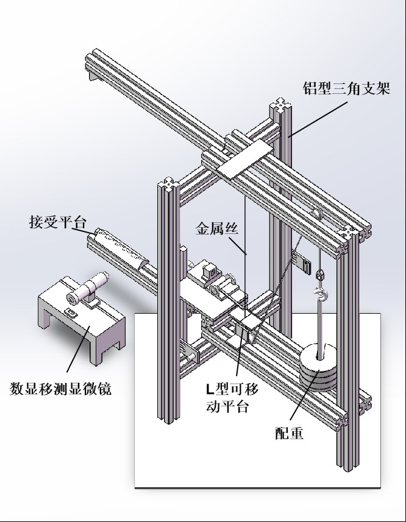
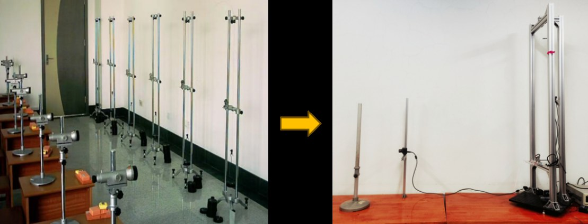
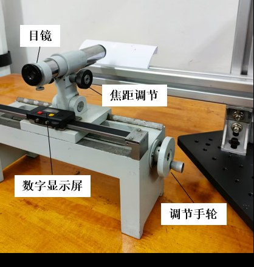
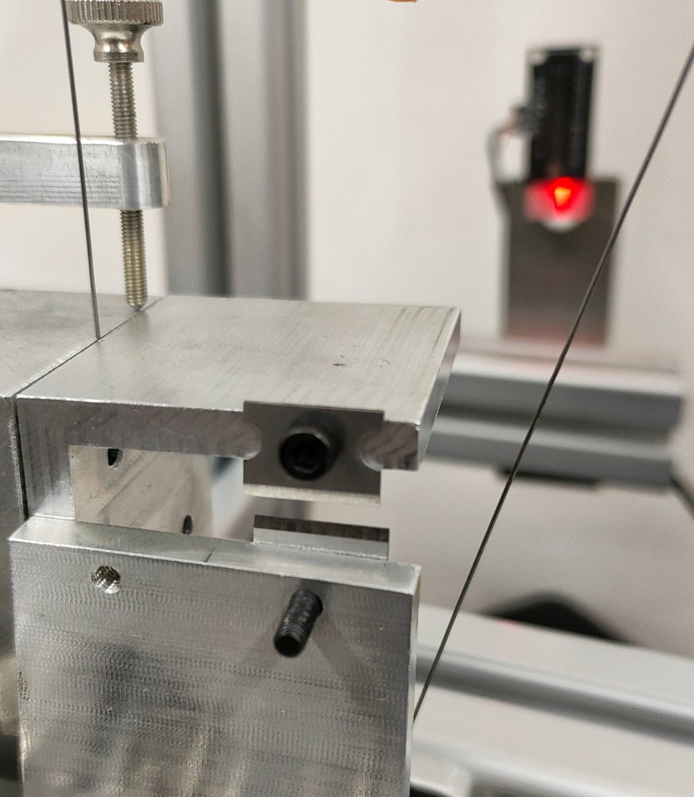
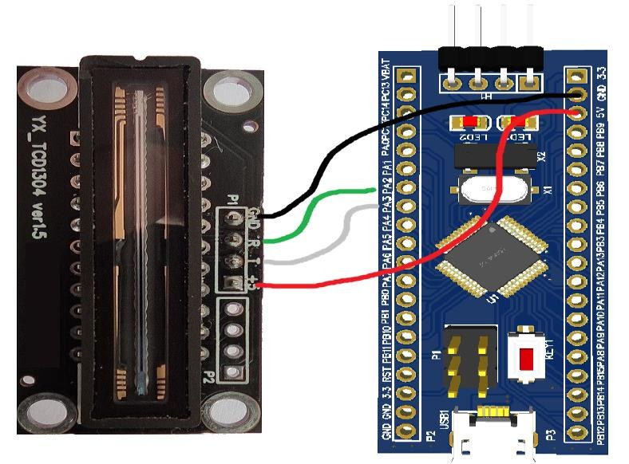

# Visual Supplement

The images here are pulled from our original Word/PPT materials in `docs/source-materials/`. We included them so you can get a visual sense of the project directly on GitHub without having to download the office files first.

## Instrument Overview

## Mechanical And Optical Structure

## Projection Method And CCD Module

## Software Interface

---

# 中文版本

这些图片提取自 `docs/source-materials/` 中的原始 Word/PPT 材料。放在这里是为了让大家不用下载原始文件，就能在 GitHub 上直观地看到项目的样子。

## 仪器总览

## 机械与光学结构

## 投影法与 CCD 模块

## 软件界面

